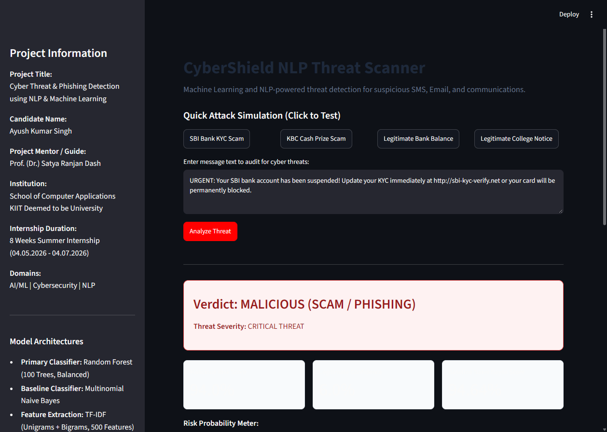
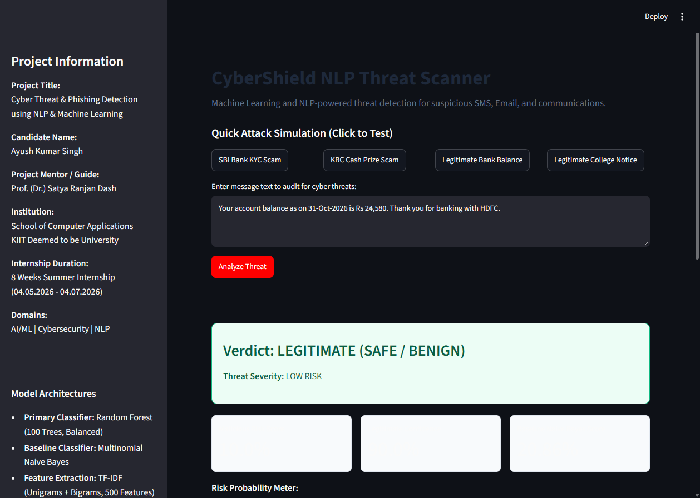

# Cyber Threat and Phishing Detection using Natural Language Processing and Machine Learning

Practical Training Project submitted in partial fulfillment of the requirements for the Summer Internship Program (04.05.2026 - 04.07.2026).

Candidate: Ayush Kumar Singh  
Institution: School of Computer Applications, KIIT Deemed to be University, Bhubaneswar, Odisha  
Project Mentor / Supervisor: Prof. (Dr.) Satya Ranjan Dash  
Target Domain: Artificial Intelligence, Natural Language Processing, and Cybersecurity  

---

## 1. Project Overview

Social engineering attacks, email phishing, and SMS smishing represent over 80% of initial access vectors in modern enterprise security breaches. Attackers leverage psychological triggers such as artificial urgency, financial extortion, fear of legal repercussions, and brand impersonation to manipulate victims into divulging sensitive credentials or transferring assets.

This project delivers an end-to-end Machine Learning and Natural Language Processing (NLP) system designed to detect, classify, and explain cyber threats in real-time. By extracting term frequency-inverse document frequency (TF-IDF) feature representations with unigram and bigram tokenization and evaluating them through Random Forest and Multinomial Naive Bayes classifiers, the system achieves robust threat classification with explainable AI keyword attribution.

---

## 2. Key Features

- Balanced Threat Dataset: 100 domain-specific records covering banking notices, transactional updates, personal messages, and enterprise notifications (Legitimate / Ham) against KYC phishing, lottery scams, SIM deactivation threats, utility extortion, fake job offers, and crypto drainer scams (Malicious).
- Dual Machine Learning Architecture:
  - Production Model: Random Forest Classifier (100 estimators, balanced class weights, Gini impurity criterion).
  - Baseline Model: Multinomial Naive Bayes (Laplace smoothing alpha=0.5).
- Explainable AI (XAI) Keyword Inspector: Pinpoints the specific linguistic tokens driving threat risk scores (e.g., 'urgent', 'kyc', 'suspended', 'immediately', 'pan card').
- Interactive Streamlit Security Dashboard: A web-based operations console featuring real-time risk gauges, multi-channel threat simulation presets (Banking KYC, Lottery scam, Electricity bill cutoff, SIM block, Legitimate salary credit), and telemetry charts.
- 15-Page Academic Practical Training Report: Complete publication-ready report and generated PDF matching KIIT School of Computer Applications guidelines.
- Zero-Hardware Dependency: Operates on any standard CPU without requiring specialized GPU accelerators or external webcam hardware.

---

## 3. Application Screenshots & Live Triage Demonstration

### Phishing Threat Detection & Explainable AI (XAI) Attribution
Real-time analysis of an urgent banking scam showing the red severity card, 93.0% malicious probability meter, and the exact keywords triggering the alert:


### Legitimate Communication Analysis (Safe Verification)
Verification of benign banking balance notices resulting in safe green classification with 10.0% threat risk:


---

## 4. System Architecture

The data pipeline and inference architecture follow an end-to-end security screening flow:

```
[Raw Incoming Communication (Email / SMS / Message)]
                        |
                        v
        [Text Preprocessing & Normalization]
      (Lowercasing, Tokenization, Regex Stripping)
                        |
                        v
          [TF-IDF Feature Extraction]
    (Unigrams + Bigrams, Sublinear Term Frequency)
                        |
                        v
      +-----------------+-----------------+
      |                                   |
      v                                   v
[Random Forest Classifier]     [Multinomial Naive Bayes]
 (100 Decision Trees)           (Baseline Probabilistic)
      |                                   |
      +-----------------+-----------------+
                        |
                        v
        [Probability Calibration & Scoring]
                        |
                        v
        [Explainable Keyword Attribution]
                        |
                        v
[Streamlit Security Dashboard / API Response]
(Safe < 40% | Suspicious 40%-70% | Critical Threat > 70%)
```

---

## 5. Evaluation Telemetry

Evaluated on stratified out-of-sample holdout test data (25% split):

| Metric | Random Forest (Production) | Naive Bayes (Baseline) |
| :--- | :--- | :--- |
| Accuracy | 84.00% | 80.00% |
| Precision (Malicious) | 100.00% | 78.57% |
| Recall (Malicious) | 66.67% | 91.67% |
| F1-Score | 80.00% | 84.62% |
| ROC-AUC | 98.72% | 96.15% |

Confusion Matrix (Random Forest):
- True Negatives (Correctly identified Legitimate): 13
- False Positives (Legitimate marked as Malicious): 0 (Zero False Alarms)
- False Negatives (Malicious marked as Legitimate): 4
- True Positives (Correctly identified Malicious): 8

The 100.00% precision of Random Forest ensures that legitimate communications are never blocked or falsely flagged as malicious, preventing alert fatigue in security operations centers (SOC).

---

## 6. Repository Structure

```
cyber-threat-detector-nlp/
|-- dataset/
|   |-- generate_dataset.py       # Script to generate balanced dataset
|   `-- threat_dataset.csv        # 100 balanced threat and legitimate samples
|-- models/
|   |-- classifier_rf.joblib      # Serialized Random Forest model
|   |-- classifier_nb.joblib      # Serialized Naive Bayes model
|   |-- tfidf_vectorizer.joblib   # Fitted TF-IDF feature transformer
|   `-- model_metrics.joblib      # Evaluation metrics cache
|-- src/
|   |-- train.py                  # Model training, validation and export pipeline
|   `-- predict.py                # Standalone inference and explainability engine
|-- report/
|   |-- Practical_Training_Report.md  # 15-page comprehensive KIIT internship report (Markdown)
|   |-- Practical_Training_Report_Ayush_Kumar_Singh.pdf  # Exact 15-page publication-ready PDF
|   |-- generate_pdf.py           # Automated PDF generation pipeline
|   |-- threat_analysis_screenshot.png  # Live triage demonstration exhibit
|   |-- safe_analysis_screenshot.png    # Live safe message verification exhibit
|   `-- dashboard_screenshot.png        # Operational console exhibit
|-- app.py                        # Streamlit interactive security web application
|-- run_app.bat                   # 1-click Windows desktop launcher
|-- requirements.txt              # Production dependency specifications
`-- README.md                     # Documentation and reproduction guide
```

---

## 7. Installation and Execution

### Prerequisites
- Python 3.10 to 3.13 installed on the system.
- Standard command line terminal (PowerShell, Bash, or Command Prompt).

### Step 1: Clone Repository
```bash
git clone https://github.com/ayushkumarsinghh/cyber-threat-detector-nlp.git
cd cyber-threat-detector-nlp
```

### Step 2: Install Dependencies
```bash
pip install -r requirements.txt
```

### Step 3: Run Model Training (Optional, pre-trained weights included)
```bash
python src/train.py
```

### Step 4: Launch Web Dashboard
Windows 1-Click:
Double-click `run_app.bat` or run:
```bash
streamlit run app.py
```
Open your browser at `http://localhost:8501`.

---

## 8. Academic Verification & Credits

This project was developed by Ayush Kumar Singh during the 8-Week Summer Internship (04.05.2026 to 04.07.2026) at the School of Computer Applications, KIIT Deemed to be University, Bhubaneswar, Odisha.

Project Mentor / Supervisor: Prof. (Dr.) Satya Ranjan Dash, School of Computer Applications, KIIT  
Head of Department: Prof. (Dr.) Veena Goswami, Director General, School of Computer Applications, KIIT  
